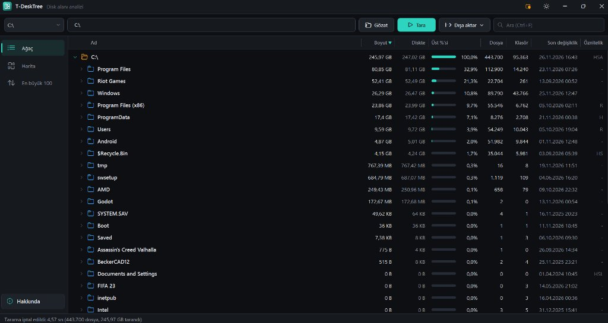

<div align="center">


<h1>T-DeskTree</h1>

<p>
  <strong>Diskinizde hangi klasörün ve dosyanın ne kadar yer kapladığını NTFS MFT hızıyla saniyeler içinde gösteren modern Windows disk analiz aracı.</strong>
</p>

<p>
  <a href="https://github.com/taha-sa/t-desktree-releases/releases/latest">
    
  </a>
  
  
  
  <a href="https://github.com/taha-sa/t-desktree-releases/releases">
    
  </a>
</p>

<p>
  <a href="#-öne-çıkan-özellikler">Özellikler</a> •
  <a href="#-indir-ve-kur">İndir & Kur</a> •
  <a href="#-sistem-gereksinimleri">Gereksinimler</a> •
  <a href="#-gizlilik-ve-güvenlik">Güvenlik</a> •
  <a href="#-t-suite-ekosistemi">T-Suite</a>
</p>

</div>

<p align="center">
  
</p>

> **Not:** Bu depo yalnızca resmi derlenmiş Windows kurulum dosyasını, taşınabilir (portable) arşivi, güncelleyici manifestini ve `SHA-256` doğrulama özetlerini barındırır.

---

## ✨ Öne Çıkan Özellikler

| Özellik | Detay |
|---|---|
| 🚀 **NTFS MFT Ultra-Hızlı Tarama** | NTFS Master File Table (MFT) doğrudan okuma motoruyla yüz binlerce dosyayı saniyeler içinde tarar; diğer sürücülerde ve ağ klasörlerinde yüksek hızlı yerel tarayıcıya otomatik geçer. |
| 🗺️ **Etkileşimli Treemap Görselleştirme** | Diskteki dev dosya ve klasörleri boyutlarıyla orantılı renkli bloklar halinde anında görün, üzerine tıklayarak doğrudan ilgili dizine dalın. |
| 🌳 **Klasör Ağacı & Oransal Doluluk Çubukları** | Her klasörün gerçek boyutunu, dosya/alt klasör sayısını ve üst dizine göre yer kaplama yüzdesini tek bakışta okuyun. |
| 📊 **Uzantı & Kategori Analizi** | Diskinizin ne kadarının Video, Arşiv, Uygulama, Görsel veya Belge tarafından kullanıldığını dosya uzantılarına göre özetleyin. |
| 🏆 **En Büyük Dosyalar & Yaş Dağılımı** | Diskte en çok yer kaplayan dosyaları (Top List) tek listede yakalayın; unutulmuş eski dosyaları **Yaş Dağılımı** görünümüyle tespit edin. |
| 📤 **Hızlı İşlemler & Rapor Dışa Aktarma** | Dosya/klasörleri doğrudan Windows Gezgini'nde açın, gereksiz dosyaları güvenle silin ve tarama sonuçlarını rapor olarak dışa aktarın. |
| 🌗 **Modern Koyu/Açık Tema & T-Suite** | Akıcı WPF arayüzü (~715 KB taşınabilir boyut), **T-Bridge Hub** entegrasyonu ve ECDSA imzalı uygulama içi güncelleme. |

---

## 📥 İndir ve Kur

### 👉 [En Son Sürümü İndir (Latest Release)](https://github.com/taha-sa/t-desktree-releases/releases/latest)

| Dosya | Açıklama | Platform |
|---|---|---|
| `T-DeskTree-Setup-1.2.0.exe` | Resmi Windows kurulum paketi | Windows 10/11 (x64) |
| `T-DeskTree.zip` | Kurulumsuz taşınabilir (Portable) sürüm (~715 KB) | Windows 10/11 (x64) |
| `SHA256SUMS.txt` | Bütünlük doğrulama özetleri | Tümü |

<details>
<summary><strong>📌 Kurulum Notları (NTFS MFT Hızı · SmartScreen · SHA-256)</strong></summary>

<br/>

- **Maksimum Tarama Hızı:** T-DeskTree standart kullanıcı yetkisiyle de çalışır; ancak NTFS sürücülerde en yüksek MFT tarama hızından yararlanmak için Yönetici olarak çalıştırmanız önerilir.
- **Windows SmartScreen:** İlk kurulumda uyarı ekranı çıkarsa **Ek bilgi → Yine de çalıştır** seçeneğini kullanabilirsiniz.

```powershell
Get-FileHash .\T-DeskTree-Setup-1.2.0.exe -Algorithm SHA256
# Çıktıyı sürüm sayfasındaki SHA256SUMS.txt ile karşılaştırın.
```

</details>

---

## 💻 Sistem Gereksinimleri

- **İşletim Sistemi:** Windows 10 veya Windows 11 (64-bit)
- **Dosya Sistemleri:** NTFS (MFT hızlandırma), FAT32, exFAT ve standart klasör yolları
- **Arayüz Dilleri:** Türkçe (TR) · English (EN) · Deutsch (DE)

---

## 🔒 Gizlilik ve Güvenlik

- **%100 Çevrimdışı Analiz:** Dosya adlarınız, klasör yapınız ve disk raporlarınız hiçbir sunucuya gönderilmez.
- **Sıfır Telemetri:** Analitik, reklam veya arka plan izleme kodu barındırmaz.
- **İmzalı Güncellemeler:** Uygulama içi güncellemeler kriptografik imza doğrulamasıyla çalışır.

---

## 🧩 T-Suite Ekosistemi

| Uygulama | Ne İşe Yarar? | Platform | Sürüm Deposu |
|---|---|---|---|
| **T-Bridge** | Windows & Android arası dosya, pano, bildirim, kumanda ve T-Suite Hub | Windows, Android | [taha-sa/t-bridge-releases](https://github.com/taha-sa/t-bridge-releases) |
| **T-Downloader** | Çok parçacıklı indirme yöneticisi + video/HLS + tarayıcı eklentisi | Windows, Chrome/Edge/Brave | [taha-sa/t-downloader-releases](https://github.com/taha-sa/t-downloader-releases) |
| **T-DeskTree** *(bu depo)* | NTFS MFT ultra hızlı disk & klasör analizi + Treemap | Windows | [taha-sa/t-desktree-releases](https://github.com/taha-sa/t-desktree-releases) |
| **T-RamCash** | 5 katmanlı RAM temizleyici ve canlı sistem tepsisi izleyici | Windows | [taha-sa/t-ramcash-releases](https://github.com/taha-sa/t-ramcash-releases) |
| **T-Desk Viewer** | PDF, Office, EPUB, Kod & ZIP mobil belge görüntüleyici | Android | [taha-sa/tdesk-viewer-releases](https://github.com/taha-sa/tdesk-viewer-releases) |

<details>
<summary><strong>🇬🇧 English Summary</strong></summary>

<br/>

**T-DeskTree** is an ultra-fast Windows disk space analyzer (~715 KB portable) featuring direct NTFS MFT scanning, interactive Treemap visualization, hierarchical percentage bars, file extension & age distribution stats, Top Largest Files view, report export, dark/light themes, and zero telemetry in Turkish, English, and German.

</details>

---

<p align="center">
  Hata bildirimi veya özellik önerisi için <a href="https://github.com/taha-sa/t-desktree-releases/issues">Issues</a> sekmesini kullanabilirsiniz · <a href="https://github.com/taha-sa">T-Suite Ekosistemi</a>
</p>